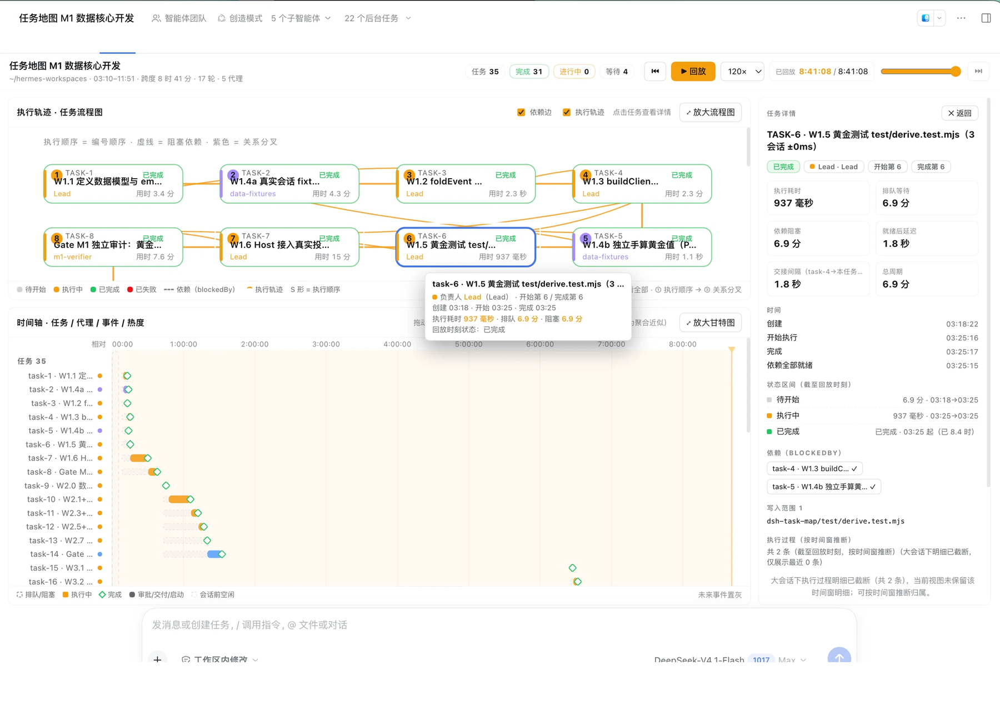
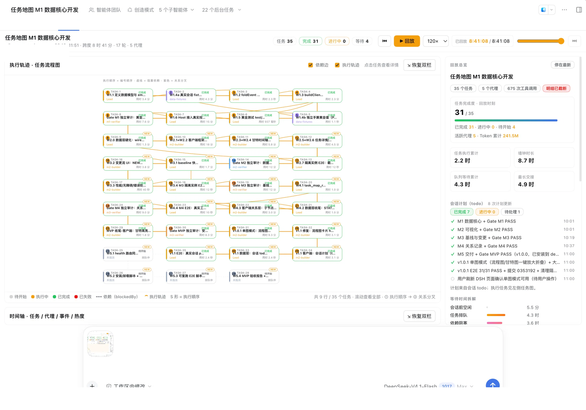

# DSH Task Map（任务地图）


把一次 DeepSeek Harness 会话变成**可回放的任务地图**：任务流程图、甘特时间轴、导航式回放、等待拆解、计划/变更流、任务关系支线。只读派生，不改任务状态、不写会话日志、不联网。

> A read-only observability plugin for DeepSeek Harness: replay a session as a task map (SVG flow + Gantt + replay clock), analyze waits, diff plan vs. execution, and record display-only task relations.





## 功能

- **任务流程图**：按执行顺序的 S 形布局、`blockedBy` 依赖曲线、关系分叉（支线）、轨迹生长、状态色、负责人色条、NEW 标记、计划未创建 Ghost；卡片标题最多两行（超长省略号），长标题不再被 16 字硬截断；
- **流程图交互**：连线有流动方向动画（执行顺序 / 依赖 / 关系）；悬停任一连线只聚焦该线两端节点，点击卡片聚焦自身与所有直连节点（其余节点灰度显示、其余连线淡出），再次点击取消；点击卡片不再出现浏览器焦点外框；
- **甘特时间轴**：任务/代理/事件/热度四类行、会话前空闲带、播放头拖动、视口窗口化（200 任务降级）；
- **导航式回放**：单一回放时钟 + `requestAnimationFrame`，60×/120×/300×/600×，播放/暂停/拖动/键盘（空格、←→、Esc），任意时刻状态可复现，未来事件不剧透；
- **任务详情**：按回放时刻推导状态、状态区间、执行/排队/依赖阻塞/就绪延迟/交接、依赖与写入范围、按时间窗推断的执行过程、变更历史；
- **回放总览**：完成度、活跃代理、token、等待拆解（会话前空闲 / 任务排队 / 依赖阻塞 / 等待代理 / 审批 / 人工空闲 / 最长交接）、累计 vs 墙钟；
- **会话计划（todo）**：会话 `todo_write` 清单与团队任务并存展示（计数 + 清单 + 更新时间，只读）；
- **计划基线 vs 变更**：基线快照、新增/移除/依赖变更/拆分、变更记录点击跳转回放时刻；
- **关系记录**：`task_map_record_relation` 只读校验任务 id 后记录父子/拆分关系，渲染支线；父任务完成但子任务未完成只提示、不改状态；
- **单图模式**：流程图/甘特图一键放大折叠（大屏一次只看一个图），窗口 resize / 最大化自适应；
- **键盘无障碍**：Tab 焦点、Enter/Space 选择、`aria-*`、`prefers-reduced-motion`（连线流向动画自动关闭）；暗/亮主题适配。

## 快速开始

### 环境要求

- DeepSeek Harness `0.2.1-rc.5`（`engines.dsh: >=0.2.1-rc.5 <0.3.0`）
- Node.js ≥ 20（仓库自带无构建链的纯 JS 客户端/服务端两半）

### 安装（从源码 link 安装）

```bash
git clone https://github.com/xiaohui-zhangxh/dsh-task-map.git
cd dsh-task-map

# 安装到日常 DSH（desktop profile）
./scripts/install.sh

# 或指定 profile / 隔离 DSH_HOME 演练
PROFILE=web ./scripts/install.sh
DSH_HOME=/tmp/dsh-lab PROFILE=web ./scripts/install.sh
```

安装后**重启 DSH**（桌面端退出重开 / 重启 `dsh web`）。打开任一使用过 Agent Teams 任务板（或 `todo_write` 清单）的会话，在会话头部页签选择 **「任务地图」**。

### 使用

1. 看任务图/甘特；点节点或甘特条看任务详情；
2. 拖动时间轴或点「▶ 回放」复盘，任意时刻右侧总览/详情同步；
3. 大屏想只看一个图：点面板右上角「⤢ 放大流程图」/「⤢ 放大甘特图」，再点「⇲ 恢复双栏」还原。

### 卸载

```bash
./scripts/uninstall.sh            # 清理 profile bundles / dependencies / node_modules 链接
```

也可以在 DSH 插件中心关闭开关；如界面仍有残留，刷新一次页面（客户端模块热卸载在少数情况下可能未同步）。

### 安全

- `/task-map/api/health` 同源校验（浏览器同源 200；裸请求/跨源 403），仅返回非敏感运行状态；
- 插件只读派生：**不写会话日志、不改任务状态、不联网**；关系工具只做只读校验 + 返回记录参数（关系由会话日志中的 tool/call 事件重建）。

## 工作原理

```text
会话事件日志 ──► Host 投影（lib/derive.js：foldEvent/buildClientView）──► wire.view ──► Client 页签
                     │                                                                    │
                     ├─ 任务状态历史 / 依赖 / 负责人 / 指标 / spans                        ├─ 任务流程图（SVG）
                     ├─ 计划基线 + 变更流（diff、as-of 过滤）                              ├─ 甘特时间轴（窗口化）
                     ├─ todo 计划（与团队任务并存）                                        ├─ 回放引擎（单时钟 + rAF）
                     └─ 关系（tool/call 参数解析，只记录）                                 └─ 详情 / 总览 / 变更 / 计划
```

- Host 半：`index.js`（投影 `stateVersion=4` + 2 个 Agent 工具 + health 路由）；
- Client 半：`client.js`（单文件 CJS factory，仅 `require('react')`，纯 SVG 手绘，无构建链）；
- 体积 guard：`wire.view` 按任务/span 规模分级降级（描述截断、span 仅保留最近 N 条 + 聚合摘要），200 任务 < 200KB 上限；等待指标独立累加不受截断影响。

## 开发与测试

```bash
npm test                       # 全部：derive + host + client-smoke + client-logic
node test/derive.test.mjs      # 数据核心黄金测试（307 checks，3 个真实会话脱敏 fixture）
node test/host-smoke.mjs       # Host stub ctx（投影/工具/health 鉴权，35 项）
node test/client-smoke.mjs     # 客户端组件冒烟（717 checks）
node test/client-logic.test.mjs# 客户端纯逻辑（358 checks）
```

- `test/fixtures/*.jsonl`：3 个真实会话的脱敏快照；`docs/golden-values.json`：独立 Python 手算黄金值（时间/耗时/等待 ±0ms）；
- 可复跑 E2E：`tools/e2e/task-map-e2e.mjs`（需要运行中的 DSH Web 实例 + Chrome + playwright-core，见 `docs/M5-E2E.md`）；
- 已验证行为与交付记录：`docs/`（M1~M4 独立审计、MVP 验收、安装演练、版本变更等）。

## 版本与已知限制

- 当前版本 **1.2.0**（MVP 1.0.0 + 布局/计划/清理修复 + 流程图卡片两行标题 + 连线流向/悬停与点击聚焦交互），完整变更见 [CHANGELOG.md](CHANGELOG.md)；
- 已知限制：
  - 「对话建任务 → 面板实时出现」未在隔离 web profile 端到端（无 Agent Teams）；关系工具已用真实模型调用验证；
  - 超长会话（>~60 任务）视图自动降级，详情「共 N 条」为累计口径；
  - 计划清单与团队任务不自动建立映射（计划 vs 执行两个视角，均只读）；
  - 连线流向动画仅对 ≤64 任务的流程图开启（大图性能保护）；关系分叉连线与依赖连线共用同一套悬停/聚焦逻辑；
  - P1/P2（全局会话目录页、跨会话只读查询 `task_map_query`）未实现，属 Roadmap。

## Roadmap

- [ ] P1：全局「任务地图」页（会话目录 + 单会话统计 + 跳转，不合并任务）
- [ ] P2：`task_map_query` 跨会话只读查询
- [ ] 真实 Agent Teams profile 的实时 e2e 沉淀
- [ ] 导出 PNG/HTML、长会话 as-of 聚合优化

## 免责声明

`test/fixtures/` 与 `docs/` 中的示例数据来自作者本人的真实开发会话（已做路径/会话 id 脱敏），仅用于测试与文档示例；截图中的任务内容为示例项目。发布或分发前请自行评估是否包含你不希望公开的信息。

## License

[MIT](LICENSE) © 2026 xiaohui-zhangxh
